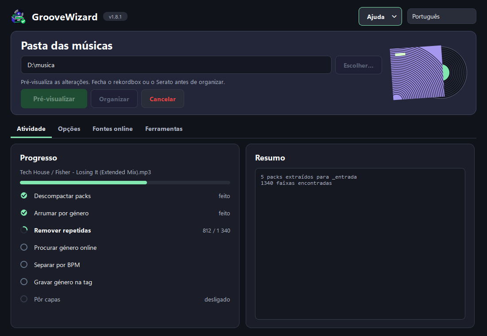
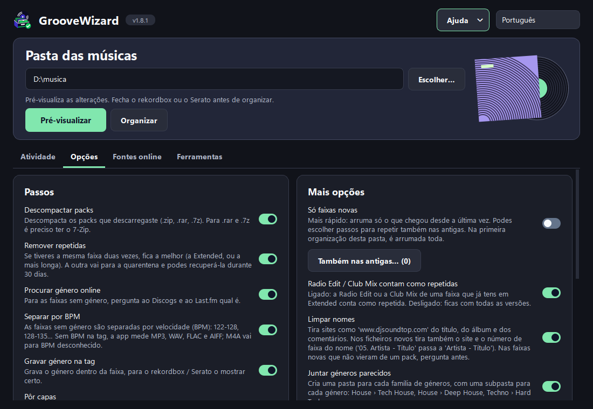
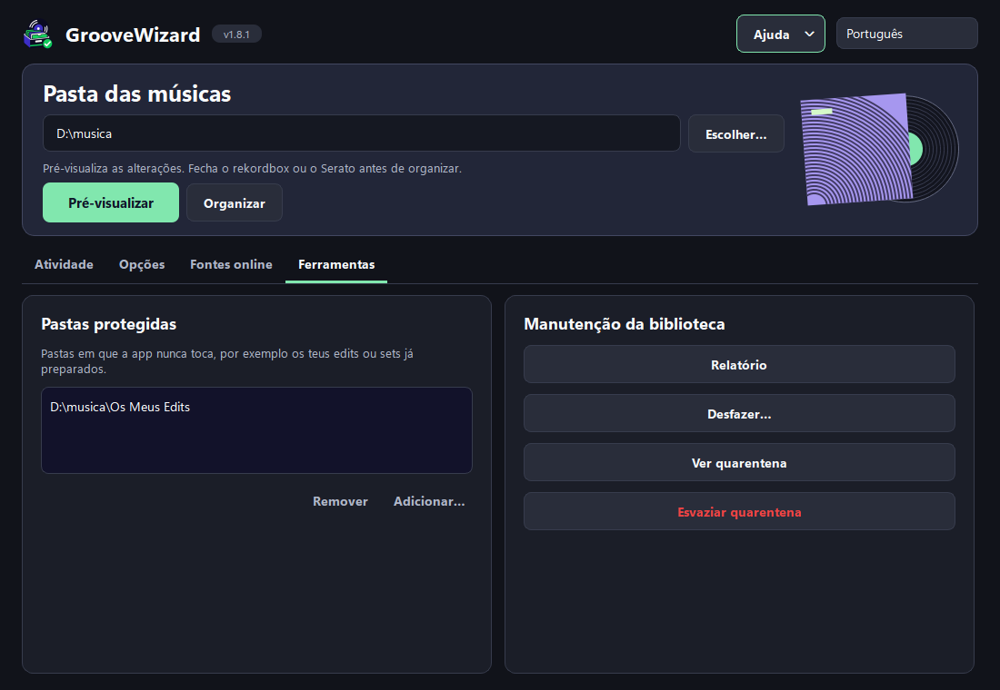
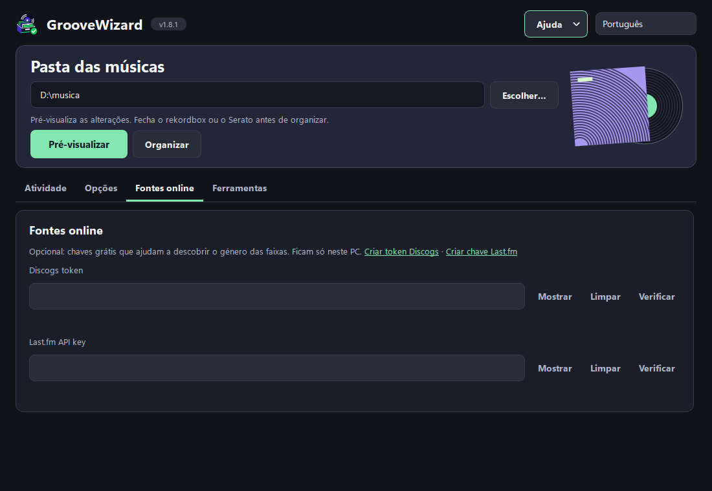
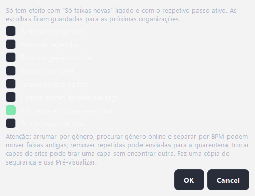
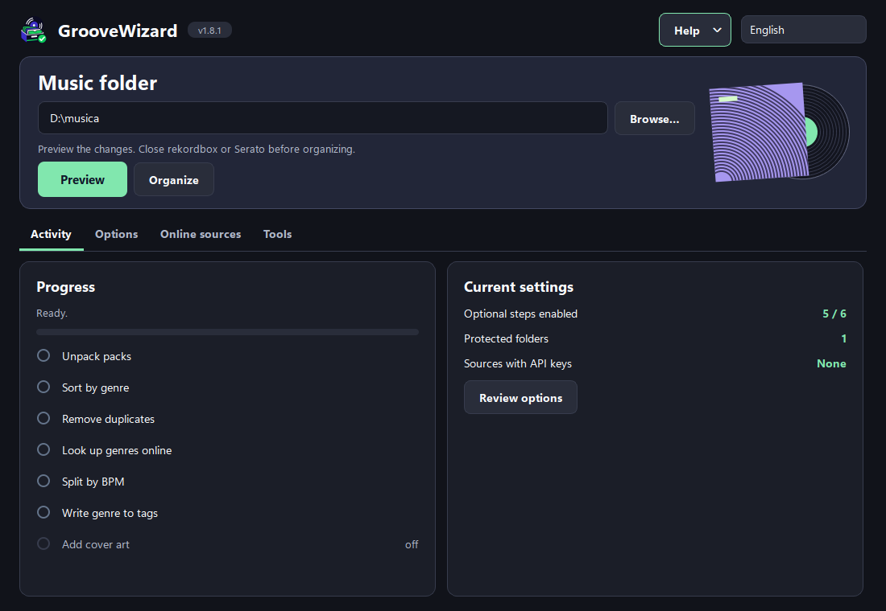

<p align="center"></p>

<h1 align="center">GrooveWizard</h1>

<p align="center">
  Arruma a tua biblioteca de música de DJ: por género e subgénero, sem repetidas, com as tags limpas.<br>
  <a href="../../releases/latest"><b>Descarregar o instalador</b></a> · Windows 10/11 · Português / English · <a href="#english">English below</a>
</p>

<p align="center">
  <a href="../../actions/workflows/testes.yml"></a>
</p>

<p align="center"><sub>Até à versão 1.1.0 chamava-se <i>Cratekeeper</i>; a atualização mantém definições, chaves e histórico. ·
Called <i>Cratekeeper</i> up to 1.1.0; updating keeps settings, keys and history.</sub></p>

<p align="center"></p>

> ⚠️ **Faz uma cópia de segurança antes da primeira utilização.** O GrooveWizard move ficheiros e altera tags. Tem
> pré-visualização, desfazer e quarentena, mas são proteções, não substituem uma cópia de segurança.

## Como usar

1. Descarrega o instalador em [Releases](../../releases/latest), [verifica o download](#verificar-o-download) e abre a app. Na primeira utilização, escolhe o idioma e lê os termos.
2. Em **Pasta das músicas**, carrega em **Escolher…** e indica a pasta da biblioteca. Em **Ferramentas → Pastas protegidas**, podes excluir os teus edits ou sets preparados.
3. Carrega em **Pré-visualizar**. Quando houver alterações previstas, abre **Ver lista**, revê as ações e desmarca as faixas que queres manter como estão.
4. Fecha o rekordbox ou o Serato. Para aplicar a seleção, usa **Organizar com as marcadas** dentro da lista. O botão **Organizar** da janela principal executa a organização completa segundo as opções atuais.
5. Acompanha o progresso em **Atividade**. No rekordbox, usa *Ficheiro → Gerir faixas inexistentes → Auto Relocate* para voltar a localizar as faixas movidas e, depois, *Recarregar tag*.

| Separador | O que encontras |
|---|---|
| **Atividade** | Configuração atual, progresso de cada passo e resumo da operação. |
| **Opções** | Passos de organização, tratamento das faixas antigas e **Desligar o PC no fim**. Se ativares esta opção, uma organização concluída sem erros inicia uma contagem de 60 segundos que podes cancelar. |
| **Fontes online** | Chaves opcionais de [Discogs](https://www.discogs.com/settings/developers) e [Last.fm](https://www.last.fm/api/account/create). **Verificar** testa a chave e **Limpar** remove-a. |
| **Ferramentas** | Pastas protegidas, relatório, histórico para desfazer e quarentena. |

A tecla **F1** abre a ajuda em qualquer separador.

## O que faz

1. **Descompacta os packs** que descarregaste (`.zip`, `.rar`, `.7z`, mesmo packs dentro de packs). Para `.rar` e `.7z` é preciso o [7-Zip](https://7-zip.org).
2. **Arruma por género**: cada faixa vai para a pasta do seu género (ex.: `House/Tech House`). Se a faixa não disser o género, usa o nome do pack (ex.: "Best New Hard Techno" → `Techno/Hard Techno`). Se não houver nada, vai para `Sem Genero`.
3. **Tira as repetidas**: se tens a mesma faixa duas vezes, fica a melhor. Por defeito, Radio Edit e Club Mix contam como a mesma faixa que Original/Extended; remixes identificados como diferentes ficam.
4. **Procura o género online** das faixas que não o têm (Discogs, Last.fm e, se quiseres, MusicBrainz). É uma estimativa, não uma garantia.
5. **Separa por BPM** as faixas sem género (`BPM 122-128`, `BPM 128-135`, …). Se a faixa não traz o BPM, a app mede-o no áudio.
6. **Limpa as tags**: grava o género dentro da faixa (o rekordbox / Serato passam a mostrá-lo) e tira nomes de sites como `www.djsoundtop.com` do título, álbum e comentários.
7. **Limpa os nomes das faixas novas**: tira o site e o número de faixa do nome do ficheiro (`05. Artista - Título` → `Artista - Título`) e, se quiseres, dá o nome `Artista - Título (Extended Mix)`. As faixas dos packs mudam logo; outras faixas novas só depois de confirmares. As que já tinhas não mudam de nome (o rekordbox deixaria de as encontrar), a não ser que ligues a opção para as faixas antigas, que pergunta antes.
8. **Agrupa géneros parecidos**: `House/Tech House`, `Techno/Hard Techno`, `Melodic & Indie/…`, `Bass & Breaks/…`, `Dance & Mainstage/…`.
9. **Pastas protegidas**: escolhes pastas em que a app nunca toca (os teus edits, sets já preparados).
10. **Só faixas novas** (opção): fica disponível depois da primeira organização completa da pasta. A partir daí, arruma só o que chegou desde a última vez. Em **Também nas antigas…** podes escolher, separadamente, quais os passos a repetir nas faixas antigas: arrumar por género, remover repetidas, procurar género online, separar por BPM, gravar género na tag, limpar sites das tags, pôr capas e trocar capas de sites. Tudo começa desligado. A comparação de repetidas pode ler a biblioteca toda, mas só altera as antigas se escolheres esse passo. As pastas protegidas continuam excluídas.
11. **Põe capas** (opção) nas faixas sem capa, com a capa do lançamento (Deezer e, com a chave, Discogs). Nunca troca uma capa que já exista. Se escolheres pôr capas também nas antigas, pesquisa as faixas sem capa da biblioteca inteira; se não encontrar uma capa, não altera a faixa. Com **Trocar capas de sites** (opção), tira as capas que são publicidade de sites ou genéricas (ex.: símbolo do Beatport) e procura a verdadeira; as de artistas e labels ficam. Se não encontrar substituta para uma capa de site, a faixa pode ficar sem capa. **Ver capas repetidas…** deixa-te marcar as de sites novos.
12. **Relatório**: mostra, sem mexer em nada, as faixas sem artista ou título, sem género, MP3 de menor qualidade, muito curtas ou com tags estragadas (lista para o Excel).

**Formatos de áudio:** MP3, FLAC, AIFF/AIF, WAV e M4A.

## Capturas

Estas capturas mostram a interface da versão em desenvolvimento neste repositório. As pastas e as faixas são exemplos. O instalador disponível em Releases pode corresponder a uma versão anterior.

| A organizar | No fim |
|---|---|
|  |  |
| **Ver lista: o que vai mudar, faixa a faixa** | **Desfazer: voltar a uma organização anterior** |
|  |  |
| **Opções de organização** | **Pastas protegidas e ferramentas** |
|  |  |
| **Fontes online** | **Passos nas faixas antigas** |
|  |  |
| **Ajuda dentro da app** | **Termos na primeira utilização (EN)** |
|  |  |
| **Aviso de versão nova** | **Interface em inglês** |
|  |  |

## Proteções

- **Pré-visualizar** não mexe em nada e mostra as mudanças que consegue prever. Não inclui faixas ainda dentro dos packs, resultados online nem limpeza de sites dentro das tags.
- **Desfazer…** mostra as últimas organizações e volta atrás até à que escolheres: as faixas regressam ao sítio, as repetidas saem da quarentena e as tags voltam ao que eram. O que não conseguir repor (apagado ou mudado à mão entretanto) aparece numa lista.
- **Quarentena**: as repetidas vão para uma pasta escondida (`_quarentena`). Depois de 30 dias, a próxima organização manda-as para a Reciclagem (ou já, com **Esvaziar quarentena**).
- As tags são gravadas primeiro numa cópia, que é verificada antes de substituir a faixa. Ficheiros estragados (que não se conseguem ler) não são mexidos. No fim, as pastas que ficaram vazias são apagadas.
- Recusa pastas perigosas (disco inteiro, pasta do utilizador, Windows, Program Files, AppData) e não deixa duas janelas organizar a mesma biblioteca.
- Pastas da pasta principal cujo nome começa por `_` (por exemplo `_Backup`) e atalhos de pasta (junções) são ignorados: a app nunca sai da biblioteca.
- Os packs são descompactados para uma pasta temporária e só ficam com o nome final quando terminam; se o PC desligar a meio, o pack é descompactado outra vez na próxima organização.
- Um pack que puseres à mão na pasta de entrada fica lá depois de descompactado, a não ser que ligues **Mandar packs para a quarentena depois de descompactar**.

## Requisitos e limites

- Windows 10 ou 11. O instalador já inclui o Python; não é preciso instalar nada além do 7-Zip (só para `.rar`/`.7z`).
- Espaço livre: o que os packs ocupam depois de descompactados, mais 1 GB de margem.
- Internet só é precisa para a procura de géneros ou capas online e para o aviso de versão nova.
- **Não mexe nas bases de dados do rekordbox ou do Serato** (playlists, cues, beat grids): só move ficheiros e altera tags. Depois de organizar, é preciso voltar a localizar os ficheiros no programa de DJ. O fluxo está documentado para o rekordbox; no Serato não foi testado.
- A deteção de repetidas e a procura online são estimativas: revê a pré-visualização e, se tiveres dúvidas, a pasta `_quarentena` antes de a esvaziar.
- O BPM das faixas sem género vem da tag; se não houver, a app tenta medi-lo no áudio. Faixas sem batida clara e M4A sem BPM na tag vão para `BPM desconhecido`.
- Cancelar a meio deixa feito o que já foi feito (e pode ser desfeito).
- Na primeira organização com a versão 1.5.0 ou posterior a app lê um pedaço de cada faixa para a reconhecer depois; numa biblioteca grande pode demorar mais, uma só vez.
- Desinstalar não apaga as definições em `%APPDATA%\GrooveWizard`.

## Perguntas frequentes

**Depois de organizar, o rekordbox mostra faixas com "!".** É normal: os ficheiros mudaram de pasta. *Gerir faixas inexistentes → Auto Relocate*.

**Os `.rar` não descompactam.** Instala o [7-Zip](https://7-zip.org).

**Ficaram muitas faixas em `Sem Genero`.** Confirma as chaves (botão **Verificar**) e liga o MusicBrainz nas opções (mais lento).

**Uma faixa foi para a quarentena e não devia.** Usa **Desfazer…**, ou copia-a de `_quarentena` de volta (a pasta está escondida: no Explorador, *Ver → Mostrar → Itens ocultos*).

**O Menu Iniciar mostra o ícone antigo depois de atualizar.** É a cache de ícones do Windows; reinicia o PC.

## Privacidade

- As chaves ficam em `%APPDATA%\GrooveWizard\config.json`, encriptadas com o Windows (DPAPI) quando disponível. Se o DPAPI falhar, ficam em texto simples nesse ficheiro. São enviadas apenas ao próprio serviço.
- Na procura online, o Discogs recebe o artista e o título; o Last.fm e o MusicBrainz recebem o artista. Com **Pôr capas** ou **Trocar capas de sites**, o Deezer (e o Discogs, se tiveres a chave) recebe o artista e o título das faixas sem capa (ou com capa de site), e as capas descarregadas ficam guardadas em `%APPDATA%\GrooveWizard\bibliotecas\`.
- Ao abrir, a app pergunta ao GitHub se há uma versão nova. Como em qualquer pedido na internet, o GitHub vê o teu IP. Isto acontece sempre, para avisar de cada versão nova.
- Caches (artistas e títulos pesquisados), registos e o histórico para desfazer ficam em `%APPDATA%\GrooveWizard\bibliotecas\`, **fora** da pasta das músicas, para não aparecerem se a partilhares no Soulseek/Nicotine+. Se a app falhar, o erro fica em `%APPDATA%\GrooveWizard\erros.log`.
- Nada é enviado aos autores.

## Verificar o download

Cada release indica o SHA-256 do instalador. No PowerShell:

```powershell
Get-FileHash .\GrooveWizard-<versão>-setup.exe -Algorithm SHA256
```

O valor tem de ser igual ao das notas da release. O botão **Atualizar** da app faz esta verificação sozinho e não abre um instalador que não bata certo.

O SHA-256 confirma que o ficheiro chegou inteiro e é o mesmo que foi publicado; não prova quem o publicou (o instalador não tem assinatura digital). Descarrega só da página de releases deste repositório.

## Para programadores

```bash
pip install -r requirements.txt
python app.py
```

- Testes: `python tests/test_pipeline.py` (também correm no GitHub a cada push, com build e arranque do `.exe`).
- Atualizar as capturas do README no Windows: `python tests/capture_docs.py`. O script abre as janelas com dados de exemplo e grava as imagens em `docs/`.
- Teste com dados reais (só lê a biblioteca, trabalha numa cópia): `python tests/teste_real.py D:\Musica D:\groovewizard-teste 150`
- Gerar o `.exe` e o instalador: `powershell -File build.ps1` → `dist\GrooveWizard\` e `dist\GrooveWizard-<versão>-setup.exe` (precisa do [Inno Setup 6](https://jrsoftware.org/isinfo.php)).
- Géneros, sinónimos de tags ("Afro House" → House), regras pelo nome dos packs e pastas-mãe: [`organizador/regras.py`](organizador/regras.py). Textos da interface (PT/EN): [`organizador/i18n.py`](organizador/i18n.py).
- Problemas e sugestões: abre uma [issue](../../issues). Problemas de segurança: reporta em privado em [Security → Report a vulnerability](../../security/advisories/new), não numa issue pública.

---

<h2 id="english">English</h2>

**GrooveWizard** tidies a DJ music library on Windows 10/11. Interface in English and Portuguese.

> ⚠️ **Back up your music before the first run.** GrooveWizard moves files and edits tags. Preview, Undo and the
> quarantine are safeguards, not a backup.

**What it does:**
- Unpacks the packs you download (zip/rar/7z, packs inside packs too; rar/7z need [7-Zip](https://7-zip.org)).
- Puts each track in the folder of its genre (from the track's genre, else from the pack name).
- Removes duplicates: the best copy stays. By default Radio Edit and Club Mix count as the same track as Original/Extended; identified remixes stay separate.
- Looks up missing genres online (Discogs, Last.fm, optionally MusicBrainz) — an estimate, not a guarantee.
- Splits tracks without a genre by BPM (measured from the audio when the track doesn't have it) and saves the genre inside each track.
- Removes website names (e.g. `www.djsoundtop.com`) from tags, and website names and track numbers (`05. `) from new tracks' file names; can name new tracks `Artist - Title (Extended Mix)`. Tracks from packs change right away, other new tracks after you confirm; tracks you already had keep their name unless you turn on the option for old tracks (it asks first).
- Optionally adds cover art to tracks without one (Deezer, and Discogs with the key); existing covers are never replaced. *Replace site covers* (option) takes out site ads and generic covers (e.g. the Beatport logo) and looks for the real one; *See repeated covers…* lets you tick the ones from new sites.
- Protected folders are never touched. *Only new tracks* becomes available after the first completed full run. Under *Also on old tracks…*, you can independently repeat genre sorting, duplicate removal, online genre lookup, BPM sorting, genre tag writing, website-name cleanup in tags, adding missing cover art, or replacing site covers on old tracks. All overrides default to off. Duplicate comparison may still read the whole library; it only changes old tracks when selected. *Report* lists tracks with problems without changing anything.
- Formats: MP3, FLAC, AIFF/AIF, WAV, M4A.

**Safeguards:** *Preview* changes nothing, but cannot show tracks still in packs, online results or site cleanup inside tags. *Undo…* goes back to recent organize runs. After 30 days, the next organize run sends old quarantine folders to the Recycle Bin. Tags are written to a checked copy first. Dangerous folders (whole drive, user folder, Windows, Program Files and AppData) are refused.

### Getting started

1. [Download the installer](../../releases/latest) and [verify its checksum](#verificar-o-download). On first launch, choose your language and review the terms.
2. Choose your **Music folder**. Use **Tools** to protect any subfolders you want to leave untouched.
3. Select **Preview**, then **See list** when changes are available. Untick any tracks you want to keep as they are.
4. Close rekordbox or Serato. Select **Organize with the ticked ones** in the list to apply your selection, or **Organize** in the main window for a full run with the current options.
5. Follow progress and results in **Activity**. To find moved tracks in rekordbox, use *File → Manage Missing Files → Auto Relocate*, then *Reload Tag*.

**Options** controls the organization steps and optional PC shutdown after a successful run. **Online sources** holds the optional Discogs and Last.fm keys. **Tools** also provides the library report, quarantine and **Undo…**. Press **F1** for help. [See the English interface](docs/7-english.png)

**Limits:** it does not touch rekordbox/Serato databases (playlists, cues, beat grids) — relocate files afterwards (documented for rekordbox; untested on Serato). Duplicate detection and online genres are heuristics. Tracks without a clear beat and M4A without a BPM tag go to `BPM unknown`. Uninstalling keeps `%APPDATA%\GrooveWizard`.

**Privacy:** API keys are DPAPI-encrypted when available; if DPAPI fails they remain plain text in `config.json`. They are sent only to their own service. Discogs receives artist and title; Last.fm and MusicBrainz receive the artist. Cover searches send artist and title to Deezer (and Discogs with a key). Nothing is sent to the authors.

**From source:** `pip install -r requirements.txt && python app.py`. Tests: `python tests/test_pipeline.py`. Bugs and ideas: open an [issue](../../issues). Security problems: report privately via [Security → Report a vulnerability](../../security/advisories/new), not in a public issue.

## Licença / License

[GPL-3.0-or-later](LICENSE). O instalador inclui componentes de terceiros com as suas licenças (mutagen GPL-2.0-or-later, Qt/PySide6 LGPL-3.0, Send2Trash BSD, Python PSF): ver [`licencas/AVISOS_TERCEIROS.md`](licencas/AVISOS_TERCEIROS.md), que inclui a oferta de código-fonte. / The installer bundles third-party components under their own licenses; see the notices file, which includes the written source offer.

rekordbox, Serato, Beatport, Discogs, Last.fm e MusicBrainz são marcas dos respetivos donos; o GrooveWizard não está associado a nenhum deles.
