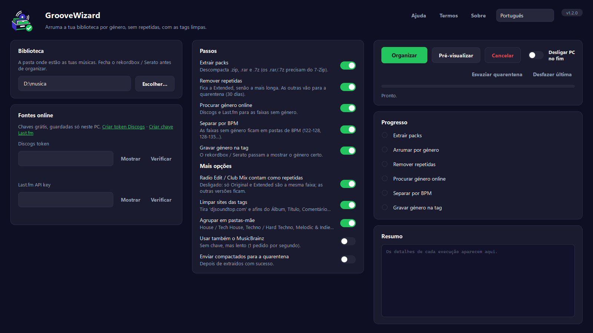
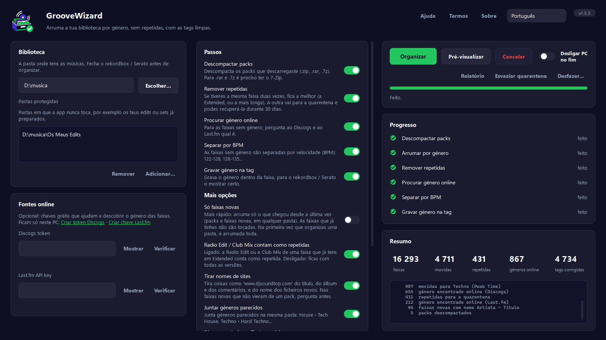

<p align="center"></p>

<h1 align="center">GrooveWizard</h1>

<p align="center">
  Arruma a tua biblioteca de música de DJ: por género e subgénero, sem repetidas, com as tags limpas.<br>
  <a href="../../releases/latest"><b>Descarregar o instalador</b></a> · Windows 10/11 · Português / English · <a href="#english">English below</a>
</p>

<p align="center">
  <a href="../../actions/workflows/testes.yml"></a>
</p>

<p align="center"><sub>Até à versão 1.1.0 chamava-se <i>Cratekeeper</i>; a atualização mantém definições, chaves e histórico. ·
Called <i>Cratekeeper</i> up to 1.1.0; updating keeps settings, keys and history.</sub></p>

<p align="center"></p>

> ⚠️ **Faz uma cópia de segurança antes da primeira utilização.** O GrooveWizard move ficheiros e altera tags. Tem
> pré-visualização, desfazer e quarentena, mas são proteções, não substituem uma cópia de segurança.

## O que faz

1. **Extrai os packs** `.zip`, `.rar` e `.7z`, incluindo packs dentro de packs (`.rar`/`.7z` precisam do [7-Zip](https://7-zip.org)).
2. **Arruma por género** pela tag Genre. Sem tag, usa o nome do pack (ex.: "Best New Hard Techno" → `Techno/Hard Techno`). Sem nada, vai para `Sem Genero`.
3. **Remove repetidas**: mesmos artistas (em qualquer ordem) + mesmo título, ignorando "Original Mix"/"Extended Mix". Fica a **Extended** (quando o nome do ficheiro ou o título dizem "Extended"), senão a mais longa, senão a lossless. Remixes diferentes e gravações com durações muito diferentes ficam as duas. Opção para manter Radio Edit / Club Mix como faixas separadas.
4. **Procura online** o género das faixas sem género: Discogs (estilos dos lançamentos onde a faixa aparece), Last.fm e, opcionalmente, MusicBrainz (estes dois por artista). O resultado é mapeado para as pastas da app; é uma estimativa, não uma garantia.
5. **Separa por BPM** as pastas `Sem Genero` e `Outros` (`BPM 122-128`, `BPM 128-135`, …).
6. **Corrige as tags**: grava o género da pasta na tag Genre (o rekordbox/Serato passam a mostrar esse género) e tira nomes de sites de download do Álbum, Título, Comentário, etc. Também tira o site do nome das faixas novas; nas que já tens, só com a opção própria, que pergunta antes (o rekordbox deixa de as encontrar e é preciso importá-las outra vez).
7. **Dá nome às faixas novas** (opção): as que saem dos packs ou que puseres na pasta `_entrada` ficam `Artista - Título (Extended Mix)` sem perguntar; outras faixas que a app nunca viu (por exemplo soltas na raiz) só depois de confirmares. Na primeira vez que organizas, só a `_entrada` conta. Nome: artista e título das tags, a versão do título ou, se lá não estiver, do nome antigo. As que já tinhas não mudam de nome, para o rekordbox continuar a encontrá-las.
8. **Agrupa em pastas-mãe**: `House/Tech House`, `Techno/Hard Techno`, `Melodic & Indie/…`, `Bass & Breaks/…`, `Dance & Mainstage/…`.
9. **Pastas protegidas**: escolhes pastas em que a app nunca mexe (edits teus, pastas já preparadas).
10. **Só faixas novas** (opção): só mexe na `_entrada` e nas faixas que a app ainda não conhecia. Mais rápido; o resto fica como está.
11. **Relatório**: sem mexer em nada, lista as faixas sem artista/título, sem género, MP3 abaixo de 320 kbps, com menos de 1 minuto ou com tags estragadas (CSV para o Excel).

**Formatos de áudio:** MP3, FLAC, AIFF/AIF, WAV e M4A.

## Capturas

| A organizar | No fim |
|---|---|
|  |  |
| **Ajuda dentro da app** | **Termos na primeira utilização (EN)** |
|  |  |
| **Aviso de versão nova** | **Interface em inglês** |
|  |  |

## Proteções

- **Pré-visualizar** mostra o que vai mudar, sem mexer em nada, e **Ver lista** mostra-o faixa a faixa: podes desmarcar faixas para ficarem como estão. Não consegue prever as faixas que ainda estão dentro dos packs, os resultados da procura online nem a limpeza de sites nas tags.
- **Desfazer…** mostra as últimas execuções e desfaz até à que escolheres, da mais recente para a mais antiga: devolve os ficheiros, repõe as tags originais e desfaz a extração dos packs. Não consegue repor o que entretanto foi apagado, mudado à mão, esvaziado da quarentena ou ocupado por outro ficheiro com o mesmo nome; nesses casos diz quais.
- **Quarentena**: repetidas e lixo vão para `_quarentena` (pasta escondida dentro da biblioteca). Passados 30 dias, são enviados para a Reciclagem na próxima vez que organizares (ou já, com **Esvaziar quarentena**).
- As tags são gravadas numa cópia verificada antes de substituir o original. Ficheiros que o mutagen não consegue abrir de todo não são movidos nem alterados. No fim, as pastas que ficaram vazias são removidas.
- Recusa pastas perigosas (disco inteiro, pasta do utilizador, Windows, Program Files, AppData) e não deixa duas janelas organizar a mesma biblioteca.

## Como usar

1. Descarrega `GrooveWizard-<versão>-setup.exe` em [Releases](../../releases/latest) e confirma o ficheiro (ver [Verificar o download](#verificar-o-download)). O instalador não tem assinatura digital, por isso o Windows SmartScreen pode avisar.
2. Na primeira vez escolhe o idioma e aceita os termos.
3. Escolhe a pasta das músicas.
4. (Recomendado) cola as chaves grátis e carrega em **Verificar**:
   - Discogs: <https://www.discogs.com/settings/developers> → *Generate new token*
   - Last.fm: <https://www.last.fm/api/account/create> (só precisas da *API key*)
5. **Fecha o rekordbox/Serato**, carrega em **Pré-visualizar** e depois em **Organizar**. Para deixar a correr de noite, liga **Desligar PC no fim**: se a organização terminar sem erros, o PC desliga-se (com 60 s para cancelar). Se houver um erro ou cancelares, fica ligado.
6. No rekordbox: *Ficheiro → Gerir faixas inexistentes → Auto Relocate* (escolhe a pasta), depois *Recarregar tag*.

Ajuda completa dentro da app (botão **Ajuda** ou F1).

## Requisitos e limites

- Windows 10 ou 11. O instalador já inclui o Python; não é preciso instalar nada além do 7-Zip (só para `.rar`/`.7z`).
- Espaço livre: o que os packs ocupam depois de extraídos, mais 1 GB de margem.
- Internet só é precisa para a procura online e para o aviso de versão nova.
- **Não mexe nas bases de dados do rekordbox ou do Serato** (playlists, cues, beat grids): só move ficheiros e altera tags. Depois de organizar, é preciso voltar a localizar os ficheiros no programa de DJ. O fluxo está documentado para o rekordbox; no Serato não foi testado.
- A deteção de repetidas e a procura online são estimativas: revê a pré-visualização e, se tiveres dúvidas, a pasta `_quarentena` antes de a esvaziar.
- No instalador, o BPM vem só da tag; faixas sem BPM na tag vão para `BPM desconhecido`.
- Cancelar a meio deixa feito o que já foi feito (e pode ser desfeito).
- Na primeira organização com a versão 1.5.0 a app lê um pedaço de cada faixa para a reconhecer depois (16 mil faixas num disco rígido: uns 5 minutos, uma só vez).
- Desinstalar não apaga as definições em `%APPDATA%\GrooveWizard`.

## Perguntas frequentes

**Depois de organizar, o rekordbox mostra faixas com "!".** É normal: os ficheiros mudaram de pasta. *Gerir faixas inexistentes → Auto Relocate*.

**Os `.rar` não são extraídos.** Instala o [7-Zip](https://7-zip.org).

**Ficaram muitas faixas em `Sem Genero`.** Confirma as chaves (botão **Verificar**) e liga o MusicBrainz nas opções (mais lento).

**Uma faixa foi para a quarentena e não devia.** Usa **Desfazer…**, ou copia-a de `_quarentena` de volta (a pasta está escondida: no Explorador, *Ver → Mostrar → Itens ocultos*).

**O Menu Iniciar mostra o ícone antigo depois de atualizar.** É a cache de ícones do Windows; reinicia o PC.

## Privacidade

- As chaves ficam em `%APPDATA%\GrooveWizard\config.json`, encriptadas com o Windows (DPAPI) sempre que o Windows o permite; só o teu utilizador neste PC as consegue ler. São enviadas apenas ao próprio serviço (Discogs ou Last.fm), na procura online e quando carregas em **Verificar**.
- Na procura online, o Discogs recebe o artista e o título; o Last.fm e o MusicBrainz recebem o artista.
- Ao abrir, a app pergunta ao GitHub se há uma versão nova. Como em qualquer pedido na internet, o GitHub vê o teu IP. Isto acontece sempre, para avisar de cada versão nova.
- Caches (artistas e títulos pesquisados), registos e o histórico para desfazer ficam em `%APPDATA%\GrooveWizard\bibliotecas\`, **fora** da pasta das músicas, para não aparecerem se a partilhares no Soulseek/Nicotine+. Se a app falhar, o erro fica em `%APPDATA%\GrooveWizard\erros.log`.
- Nada é enviado aos autores.

## Verificar o download

Cada release indica o SHA-256 do instalador. No PowerShell:

```powershell
Get-FileHash .\GrooveWizard-<versão>-setup.exe -Algorithm SHA256
```

O valor tem de ser igual ao das notas da release. O botão **Atualizar** da app faz esta verificação sozinho e não abre um instalador que não bata certo.

O SHA-256 confirma que o ficheiro chegou inteiro e é o mesmo que foi publicado; não prova quem o publicou (o instalador não tem assinatura digital). Descarrega só da página de releases deste repositório.

## Para programadores

```bash
pip install -r requirements.txt
python app.py
```

- Testes: `python tests/test_pipeline.py` (também correm no GitHub a cada push, com build e arranque do `.exe`).
- Teste com dados reais (só lê a biblioteca, trabalha numa cópia): `python tests/teste_real.py D:\Musica D:\groovewizard-teste 150`
- Medir o BPM no áudio das faixas sem BPM na tag: `pip install librosa` (opcional; não vai no instalador).
- Gerar o `.exe` e o instalador: `powershell -File build.ps1` → `dist\GrooveWizard\` e `dist\GrooveWizard-<versão>-setup.exe` (precisa do [Inno Setup 6](https://jrsoftware.org/isinfo.php)).
- Géneros, sinónimos de tags ("Afro House" → House), regras pelo nome dos packs e pastas-mãe: [`organizador/regras.py`](organizador/regras.py). Textos da interface (PT/EN): [`organizador/i18n.py`](organizador/i18n.py).
- Problemas e sugestões: abre uma [issue](../../issues). Problemas de segurança: reporta em privado em [Security → Report a vulnerability](../../security/advisories/new), não numa issue pública.

---

<h2 id="english">English</h2>

**GrooveWizard** tidies a DJ music library on Windows 10/11. Interface in English and Portuguese.

> ⚠️ **Back up your music before the first run.** GrooveWizard moves files and edits tags. Preview, Undo and the
> quarantine are safeguards, not a backup.

**What it does:** extracts downloaded packs (zip/rar/7z, nested too; rar/7z need [7-Zip](https://7-zip.org)), sorts tracks into genre/subgenre folders (by Genre tag, else by pack name), removes duplicates (same artists + title; keeps the Extended Mix when the file name or title says so, else the longest, else lossless; different remixes and recordings with very different lengths are kept), looks up missing genres online (Discogs styles of matching releases; Last.fm and MusicBrainz per artist — an estimate, not a guarantee), splits tracks without a genre by BPM, optionally names new tracks (from packs, or put in the library's `_entrada` folder) `Artist - Title (Extended Mix)` (artist and title from the tags; the version from the title, else from the old file name); other tracks the app has never seen, e.g. loose in the root, only after you confirm (tracks you already had keep their name, so rekordbox still finds them) and cleans tags (genre written from the folder; download-site names removed from Album/Title/Comment, and from new tracks' file names; existing tracks only with their own option, which asks first because rekordbox then has to import them again). Protected folders are never touched; *Only new tracks* works on `_entrada` and never-seen tracks only; *Report* lists tracks without artist/title or genre, MP3 under 320 kbps, under 1 minute or with damaged tags, without changing anything. Formats: MP3, FLAC, AIFF/AIF, WAV, M4A.

**Safeguards:** Preview changes nothing (it cannot predict tracks still inside packs, online results or site cleaning); *See list* shows it track by track and lets you untick tracks. *Undo…* lists recent runs and undoes back to the one you pick, newest first; it tries to restore files, original tags and pack extraction, and lists anything it could not restore (deleted, changed by hand, emptied from quarantine, name taken). Removed files go to a hidden `_quarentena` folder; after 30 days they are sent to the Recycle Bin on the next run, or at once with *Empty quarantine*. Tags are written to a verified copy first; files mutagen cannot open at all are never moved or edited. Folders left empty are removed at the end. Dangerous folders are refused; two windows cannot organize the same library.

**Use:** download the installer from [Releases](../../releases/latest) and [verify it](#verificar-o-download) (unsigned: SmartScreen may warn). Choose your music folder, paste free Discogs/Last.fm keys and press **Check**, close rekordbox/Serato, **Preview**, then **Organize**. Optionally turn on *Shut down when done*: the PC shuts down (60 s to cancel) only if the run finishes without errors. In rekordbox: *File → Manage Missing Files → Auto Relocate*, then *Reload Tag*.

**Limits:** it does not touch rekordbox/Serato databases (playlists, cues, beat grids) — relocate files afterwards (documented for rekordbox; untested on Serato). Duplicate detection and online genres are heuristics: review the preview and the quarantine. The installer reads BPM from tags only. Uninstalling keeps `%APPDATA%\GrooveWizard`.

**Privacy:** API keys are DPAPI-encrypted when Windows allows it and are sent only to their own service. Discogs receives artist and title; Last.fm and MusicBrainz receive the artist. At start-up the app asks GitHub for the latest version (GitHub sees your IP; always on, so every new version is announced). Caches, logs and undo history live in `%APPDATA%\GrooveWizard`, outside the music folder; crashes are written to `%APPDATA%\GrooveWizard\erros.log`. The SHA-256 in each release proves integrity (the file is the one published), not authorship: the installer is unsigned, so download only from this repository's Releases. Nothing is sent to the authors.

**From source:** `pip install -r requirements.txt && python app.py`. Tests: `python tests/test_pipeline.py`. Bugs and ideas: open an [issue](../../issues). Security problems: report privately via [Security → Report a vulnerability](../../security/advisories/new), not in a public issue.

## Licença / License

[GPL-3.0-or-later](LICENSE). O instalador inclui componentes de terceiros com as suas licenças (mutagen GPL-2.0-or-later, Qt/PySide6 LGPL-3.0, Send2Trash BSD, Python PSF): ver [`licencas/AVISOS_TERCEIROS.md`](licencas/AVISOS_TERCEIROS.md), que inclui a oferta de código-fonte. / The installer bundles third-party components under their own licenses; see the notices file, which includes the written source offer.

rekordbox, Serato, Beatport, Discogs, Last.fm e MusicBrainz são marcas dos respetivos donos; o GrooveWizard não está associado a nenhum deles.
