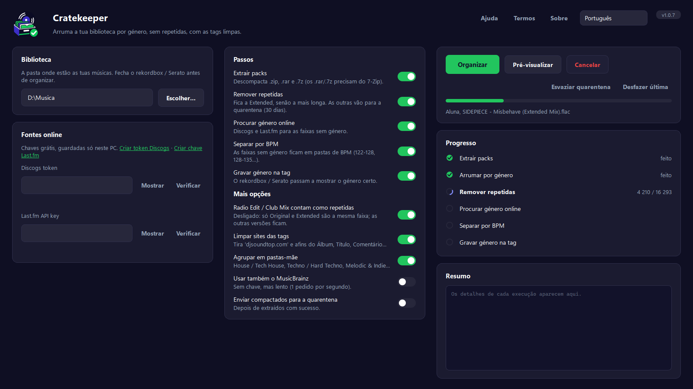

<p align="center"></p>

<h1 align="center">Cratekeeper</h1>

<p align="center">
  Arruma a tua biblioteca de música de DJ: por género e subgénero, sem repetidas, com as tags limpas.<br>
  <a href="../../releases/latest"><b>Descarregar o instalador</b></a> · Windows 10/11 · Português / English
</p>

<p align="center">
  <a href="../../actions/workflows/testes.yml"></a>
</p>

<p align="center"></p>

*English below.*

## O que faz

1. **Extrai os packs** `.zip`, `.rar` e `.7z`, incluindo packs dentro de packs (para `.rar`/`.7z` precisa do [7-Zip](https://7-zip.org)).
2. **Arruma por género** pela tag Genre. Sem tag, usa o nome do pack (ex.: "Best New Hard Techno" → `Techno/Hard Techno`).
3. **Remove repetidas**: mesmos artistas + mesmo título, ignorando "Original Mix", "feat." e a ordem dos artistas. Fica a **Extended**, senão a mais longa, senão a lossless. Remixes diferentes e gravações com durações muito diferentes ficam as duas. Opção para manter Radio Edit / Club Mix como faixas separadas.
4. **Procura online** o género das faixas sem género: Discogs (estilo da própria faixa), Last.fm e, opcionalmente, MusicBrainz.
5. **Separa por BPM** as pastas `Sem Genero` e `Outros` (`BPM 122-128`, `BPM 128-135`, …).
6. **Corrige as tags**: grava o género na tag Genre (o rekordbox/Serato passam a mostrar o género certo) e tira nomes de sites de download do Álbum, Título, Comentário, etc.
7. **Agrupa em pastas-mãe**: `House/Tech House`, `Techno/Hard Techno`, `Melodic & Indie/…`, `Bass & Breaks/…`, `Dance & Mainstage/…`.

## Seguro por defeito

- **Pré-visualizar** mostra o que vai mudar sem mexer em nada.
- **Desfazer última** anula a execução inteira: ficheiros voltam ao sítio, tags originais repostas, extração dos packs desfeita.
- **Nada é apagado de vez**: repetidas e lixo vão para `_quarentena` (pasta escondida dentro da biblioteca) durante 30 dias, só depois para a Reciclagem.
- As tags são gravadas numa cópia verificada antes de substituir o original; ficheiros com tags estragadas nunca são mexidos.
- Recusa pastas perigosas (disco inteiro, pasta do utilizador, Windows, Program Files) e não deixa duas janelas organizar a mesma biblioteca.

## Como usar

1. Descarrega `Cratekeeper-<versão>-setup.exe` em [Releases](../../releases/latest) e instala. O instalador não é assinado: se o Windows SmartScreen avisar, carrega em *Mais informações › Executar mesmo assim*.
2. Na primeira vez escolhe o idioma e aceita os termos.
3. Escolhe a pasta das músicas.
4. (Recomendado) cola as chaves grátis e carrega em **Verificar**:
   - Discogs: <https://www.discogs.com/settings/developers> → *Generate new token*
   - Last.fm: <https://www.last.fm/api/account/create> (só precisas da *API key*)
5. **Fecha o rekordbox/Serato**, carrega em **Pré-visualizar** e depois em **Organizar**.
6. No rekordbox: *Ficheiro → Gerir faixas inexistentes → Auto Relocate* (escolhe a pasta), depois *Recarregar tag*.

Ajuda completa dentro da app (botão **Ajuda** ou F1).

## Privacidade

- As chaves ficam em `%APPDATA%\Cratekeeper\config.json`, encriptadas com o Windows (só o teu utilizador neste PC as lê).
- Caches, registos e o histórico para desfazer ficam em `%APPDATA%\Cratekeeper\bibliotecas\` — **fora** da pasta das músicas, para não aparecerem se a partilhares no Soulseek/Nicotine+.
- Na procura online só é enviado o artista e o título das faixas, e só para o Discogs/Last.fm/MusicBrainz. Nada é enviado aos autores.

## Para programadores

```bash
pip install -r requirements.txt
python app.py
```

- Testes: `python tests/test_pipeline.py` (também correm no GitHub a cada push, com build e arranque do `.exe`).
- Teste com dados reais (só lê a biblioteca, trabalha numa cópia): `python tests/teste_real.py D:\Musica D:\cratekeeper-teste 150`
- Medir o BPM no áudio das faixas sem BPM na tag: `pip install librosa` (opcional; o `.exe` não o inclui e usa só o BPM da tag).
- Gerar o `.exe` e o instalador: `powershell -File build.ps1` → `dist\Cratekeeper\` e `dist\Cratekeeper-<versão>-setup.exe` (precisa do [Inno Setup 6](https://jrsoftware.org/isinfo.php)).
- Géneros, sinónimos de tags ("Afro House" → House), regras pelo nome dos packs e pastas-mãe: [`organizador/regras.py`](organizador/regras.py).
- Textos da interface (PT/EN): [`organizador/i18n.py`](organizador/i18n.py).

---

## English

**Cratekeeper** tidies a DJ music library on Windows: extracts downloaded packs (zip/rar/7z, nested too), sorts tracks into genre/subgenre folders, removes duplicates keeping the Extended Mix, looks up missing genres online (Discogs, Last.fm, MusicBrainz), splits untagged tracks by BPM and cleans tags (download-site names in Album/Title/Comment, genre lists).

Safe by default: **Preview** changes nothing; **Undo last run** reverts moves, tag edits and pack extraction; removed files stay 30 days in a hidden `_quarentena` folder before the Recycle Bin; tags are written to a verified copy first. API keys are encrypted with Windows DPAPI; caches and logs live in `%APPDATA%\Cratekeeper`, outside the music folder.

Get the installer from [Releases](../../releases/latest) (unsigned: on a SmartScreen warning choose *More info › Run anyway*). The interface is available in English and Portuguese. To run from source: `pip install -r requirements.txt && python app.py`.

## Licença / License

[MIT](LICENSE)
